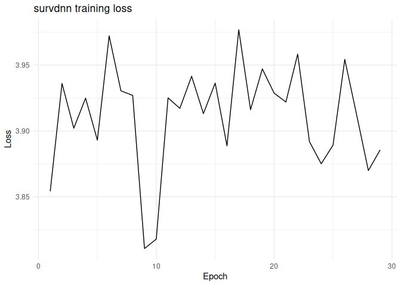
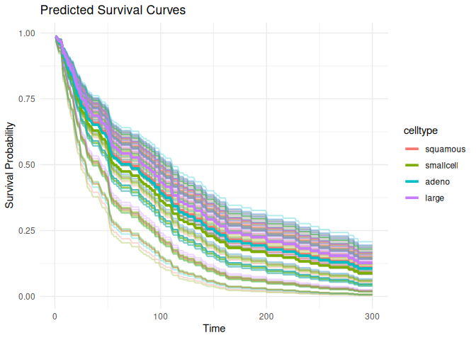
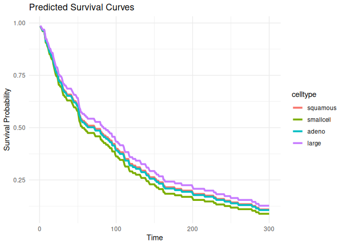

# survdnn 

> Deep Neural Networks for Survival Analysis using [R
> torch](https://torch.mlverse.org/)

[](LICENSE)  
[](https://CRAN.R-project.org/package=survdnn)  
[](https://github.com/ielbadisy/survdnn/actions/workflows/R-CMD-check.yaml)
[](https://app.codecov.io/gh/ielbadisy/survdnn)  
[](https://rjournal.github.io/articles/RJ-2026-008/)

## About

`survdnn` implements neural network-based models for right-censored
survival analysis using the native `torch` backend in R. It supports
multiple loss functions including Cox partial likelihood, L2-penalized
Cox, Accelerated Failure Time (AFT) objectives, as well as
time-dependent extension such as Cox-Time. The package provides a
formula interface, supports model evaluation using time-dependent
metrics (C-index, Brier score, IBS), cross-validation, and
hyperparameter tuning.

## Citation

Paper: [The R Journal
article](https://rjournal.github.io/articles/RJ-2026-008/)

If you use `survdnn`, please cite:

``` bibtex
@article{RJ-2026-008,
  author = {El Badisy, Imad},
  title = {SurvDNN: Survival Deep Learning Models for Tabular Data},
  journal = {The R Journal},
  year = {2026},
  volume = {18},
  number = {1},
  pages = {382--397},
  issn = {2073-4859},
  doi = {10.32614/RJ-2026-008}
}
```

``` r
citation("survdnn")
#> To cite package 'survdnn' in publications use:
#> 
#>   El Badisy I (2026). "SurvDNN: Survival Deep Learning Models for
#>   Tabular Data." _The R Journal_, *18*(1), 382-397. ISSN 2073-4859,
#>   doi:10.32614/RJ-2026-008 <https://doi.org/10.32614/RJ-2026-008>.
#> 
#> A BibTeX entry for LaTeX users is
#> 
#>   @Article{,
#>     title = {SurvDNN: Survival Deep Learning Models for Tabular Data},
#>     author = {Imad {El Badisy}},
#>     journal = {The R Journal},
#>     year = {2026},
#>     volume = {18},
#>     number = {1},
#>     pages = {382-397},
#>     issn = {2073-4859},
#>     doi = {10.32614/RJ-2026-008},
#>   }
```

## Main features

- Formula interface for `Surv() ~ .` models

- Modular neural architectures: configurable layers, activations,
  optimizers, and losses

- Built-in survival loss functions:

  - `"cox"`: Cox partial likelihood
  - `"cox_l2"`: penalized Cox
  - `"aft"`: Accelerated Failure Time
  - `"coxtime"`: deep time-dependent Cox

- Optimizers: Adam, AdamW, SGD, RMSprop, Adagrad (with custom
  `optim_args`)

- Training control: early stopping via `callback_early_stopping()` and
  loss curves via `plot_loss()`

- Evaluation: C-index, Brier score, IBS with `evaluate_survdnn()`, plus
  standalone metric helpers `cindex_survmat()`, `brier()` and
  `ibs_survmat()`

- Model selection with `cv_survdnn()`, `tune_survdnn()` and
  `gridsearch_survdnn()`, summarized with `summarize_cv_survdnn()` and
  `summarize_tune_survdnn()`

- Prediction of survival curves, risks and linear predictors via
  `predict()` and `plot()`

- Reproducibility (`.seed`), CPU thread control (`.threads`) and GPU
  support (`.device`)

- Lightweight data handling: internal wrangling uses base R and
  [`basetable`](https://CRAN.R-project.org/package=basetable), with no
  `dplyr`, `tidyr` or `purrr` dependency

## Installation

``` r
# Install from CRAN
install.packages("survdnn")

# Install the development version from GitHub
install.packages("remotes")
remotes::install_github("ielbadisy/survdnn")

# Install the torch backend libraries (once)
torch::install_torch()
```

Or clone and install locally:

``` bash
git clone https://github.com/ielbadisy/survdnn.git
R CMD INSTALL survdnn
```

## Quick example

``` r
library(survdnn)
library(survival, quietly = TRUE)
library(ggplot2)

veteran <- survival::veteran

mod <- survdnn(
  Surv(time, status) ~ age + karno + celltype,
  data = veteran,
  hidden = c(32, 16),
  epochs = 300,
  loss = "cox",
  verbose = TRUE
  )

summary(mod)
#> 
#> Formula:
#>   Surv(time, status) ~ age + karno + celltype
#> <environment: 0x5eadd74c6350>
#> 
#> Model architecture:
#>   Hidden layers:  32 : 16 
#>   Activation:  relu 
#>   Dropout:  0.3 
#>   Batch norm:  TRUE 
#>   Final loss:  3.796718 
#> 
#> Training summary:
#>   Epochs:  300 
#>   Learning rate:  1e-04 
#>   Loss function:  cox 
#>   Optimizer:  adam 
#>   Device:  cpu 
#>   CPU threads:  default 
#>   NA action:  omit 
#> 
#> Data summary:
#>   Observations (used/total): 137 / 137
#>   Predictors (5): age, karno, celltypesmallcell, celltypeadeno, celltypelarge
#>   Time range: [ 1, 999 ]
#>   Events / censored:  128  /  9 
#>   Event rate:  93.4% 
#>   Predictors standardized:  yes
```

``` r
plot(mod, group_by = "celltype", times = 1:300)
```

## Loss Functions

- Cox partial likelihood

``` r
mod1 <- survdnn(
  Surv(time, status) ~ age + karno,
  data = veteran,
  loss = "cox",
  epochs = 300
  )
#> [survdnn::fit] start: n=137 p=2 loss=cox optimizer=adam epochs=300 device=cpu
#> [survdnn::fit] epoch 50/300 loss=3.918754
#> [survdnn::fit] epoch 100/300 loss=3.896161
#> [survdnn::fit] epoch 150/300 loss=3.900485
#> [survdnn::fit] epoch 200/300 loss=3.858880
#> [survdnn::fit] epoch 250/300 loss=3.882403
#> [survdnn::fit] epoch 300/300 loss=3.879139
#> [survdnn::fit] done: epochs_run=300 final_loss=3.879139
```

- Accelerated Failure Time

``` r
mod2 <- survdnn(
  Surv(time, status) ~ age + karno,
  data = veteran,
  loss = "aft",
  epochs = 300
  )
#> [survdnn::fit] start: n=137 p=2 loss=aft optimizer=adam epochs=300 device=cpu
#> [survdnn::fit] epoch 50/300 loss=4.732642
#> [survdnn::fit] epoch 100/300 loss=4.707888
#> [survdnn::fit] epoch 150/300 loss=4.648007
#> [survdnn::fit] epoch 200/300 loss=4.584298
#> [survdnn::fit] epoch 250/300 loss=4.585914
#> [survdnn::fit] epoch 300/300 loss=4.586056
#> [survdnn::fit] done: epochs_run=300 final_loss=4.586056
```

- Coxtime

``` r
mod3 <- survdnn(
  Surv(time, status) ~ age + karno,
  data = veteran,
  loss = "coxtime",
  epochs = 300
  )
#> [survdnn::fit] start: n=137 p=2 loss=coxtime optimizer=adam epochs=300 device=cpu
#> [survdnn::fit] epoch 50/300 loss=4.010314
#> [survdnn::fit] epoch 100/300 loss=3.932604
#> [survdnn::fit] epoch 150/300 loss=3.974687
#> [survdnn::fit] epoch 200/300 loss=3.924818
#> [survdnn::fit] epoch 250/300 loss=3.922739
#> [survdnn::fit] epoch 300/300 loss=3.894928
#> [survdnn::fit] done: epochs_run=300 final_loss=3.894928
```

## Early stopping and training loss

Training can be stopped early when the loss stops improving, and the
loss trajectory can be inspected with `plot_loss()`:

``` r
mod_es <- survdnn(
  Surv(time, status) ~ age + karno + celltype,
  data = veteran,
  epochs = 500,
  optimizer = "adamw",
  callbacks = callback_early_stopping(patience = 20),
  verbose = FALSE,
  .seed = 123
  )

plot_loss(mod_es)
```



## Evaluation

`evaluate_survdnn()` computes the C-index, Brier score and integrated
Brier score at chosen time points, on the training data or on `newdata`:

``` r
evaluate_survdnn(mod1, metrics = c("cindex", "brier", "ibs"), times = c(90, 180, 300))
#> # basetable: 5 x 3
#>   metric    value time
#> 1 cindex 0.713841   NA
#> 2  brier 0.194816   90
#> 3  brier 0.157746  180
#> 4  brier 0.100056  300
#> 5    ibs 0.149207   NA
```

## Cross-validation

``` r
cv_results <- cv_survdnn(
  Surv(time, status) ~ age + karno + celltype,
  data = veteran,
  times = c(600),
  metrics = c("cindex", "ibs"),
  folds = 3,
  hidden = c(16, 8),
  loss = "cox",
  epochs = 300
  )

print(cv_results)

# mean, sd and confidence interval per metric and time
summarize_cv_survdnn(cv_results)
```

## Hyperparameter tuning

``` r
grid <- list(
  hidden     = list(c(16), c(32, 16)),
  lr         = c(1e-3),
  activation = c("relu"),
  epochs     = c(100, 300),
  loss       = c("cox", "aft", "coxtime")
  )

tune_res <- tune_survdnn(
  formula = Surv(time, status) ~ age + karno + celltype,
  data = veteran,
  times = c(90, 300),
  metrics = "cindex",
  param_grid = grid,
  folds = 3,
  refit = FALSE,
  return = "summary"
  )

print(tune_res)
```

`summarize_tune_survdnn()` aggregates the cross-validated results of
`tune_survdnn(return = "all")` per configuration.

For a single train/validation split, `gridsearch_survdnn()` evaluates
the same kind of grid on a held-out validation set:

``` r
idx   <- sample(nrow(veteran), 0.7 * nrow(veteran))
train <- veteran[idx, ]
valid <- veteran[-idx, ]

gs <- gridsearch_survdnn(
  formula = Surv(time, status) ~ age + karno + celltype,
  train = train,
  valid = valid,
  times = c(90, 300),
  metrics = c("cindex", "ibs"),
  param_grid = grid
  )
```

## Tuning and refitting the best Model

`tune_survdnn()` can be used also to automatically refit the
best-performing model on the full dataset. This behavior is controlled
by the `refit` and `return` arguments. For example:

``` r
best_model <- tune_survdnn(
  formula = Surv(time, status) ~ age + karno + celltype,
  data = veteran,
  times = c(90, 300),
  metrics = "cindex",
  param_grid = grid,
  folds = 3,
  refit = TRUE,
  return = "best_model"
  )
```

In this mode, cross-validation is used to select the optimal
hyperparameter configuration, after which the selected model is refitted
on the full dataset. The function then returns a fitted object of class
`"survdnn"`.

The resulting model can be used directly for prediction visualization,
and evaluation:

``` r
summary(best_model)

plot(best_model, times = 1:300)

predict(best_model, veteran, type = "risk", times = 180)
```

This makes `tune_survdnn()` suitable for end-to-end workflows, combining
model selection and final model fitting.

## Plot survival curves

``` r
plot(mod1, group_by = "celltype", times = 1:300)
```



``` r
plot(mod1, group_by = "celltype", times = 1:300, plot_mean_only = TRUE)
```



## Documentation

``` r
help(package = "survdnn")
?survdnn
?tune_survdnn
?cv_survdnn
?plot.survdnn
```

## Testing

``` r
# run all tests
devtools::test()
```

## Note on reproducibility

By default, `{torch}` initializes model weights and shuffles minibatches
using random draws, so results may differ across runs. Unlike
`set.seed()`, which only controls R’s random number generator, `{torch}`
relies on its own RNG implemented in C++ (and CUDA when using GPUs).

To ensure reproducibility, random seeds must therefore be set at the
Torch level as well.

`survdnn` provides built-in control of randomness to guarantee
reproducible results across runs. The main fitting function,
`survdnn()`, exposes a dedicated `.seed` argument:

``` r
mod <- survdnn(
  Surv(time, status) ~ age + karno + celltype,
  data   = veteran,
  epochs = 300,
  .seed  = 123
)
```

When `.seed` is provided, `survdnn()` internally synchronizes both R and
Torch random number generators via `survdnn_set_seed()`, ensuring
reproducible:

- weight initialization

- dropout behavior

- minibatch ordering

- loss trajectories

If `.seed = NULL` (the default), randomness is left uncontrolled and
results may vary between runs.

For full reproducibility in cross-validation or hyperparameter tuning,
the same `.seed` mechanism is propagated internally by `cv_survdnn()`
and `tune_survdnn()`, ensuring consistent data splits, model
initialization, and optimization paths across repetitions.

## CPU and core usage

`survdnn` relies on the `{torch}` backend for numerical computation. The
number of CPU cores (threads) used during training, prediction, and
evaluation is controlled globally by Torch.

By default, Torch automatically configures its CPU thread pools based on
the available system resources, unless explicitly overridden by the user
using:

``` r
torch::torch_set_num_threads(4)
```

You can also set this directly from `survdnn` APIs with `.threads`:

``` r
mod <- survdnn(
  Surv(time, status) ~ age + karno + celltype,
  data = survival::veteran,
  .threads = 4
)
#> [survdnn::fit] start: n=137 p=5 loss=cox optimizer=adam epochs=300 device=cpu
#> [survdnn::fit] cpu_threads=4
#> [survdnn::fit] epoch 50/300 loss=3.974626
#> [survdnn::fit] epoch 100/300 loss=3.878856
#> [survdnn::fit] epoch 150/300 loss=3.835840
#> [survdnn::fit] epoch 200/300 loss=3.888390
#> [survdnn::fit] epoch 250/300 loss=3.843022
#> [survdnn::fit] epoch 300/300 loss=3.779572
#> [survdnn::fit] done: epochs_run=300 final_loss=3.779572
```

The same `.threads` argument is available in `cv_survdnn()` and
`tune_survdnn()`.

This setting affects:

- model training

- prediction

- evaluation metrics

- cross-validation and hyperparameter tuning

GPU acceleration can be enabled by setting `.device = "cuda"` when
calling `survdnn()` (`cv_survdnn()` and `tune_survdnn()` too).

## Availability

The `survdnn` R package is available on
[CRAN](https://CRAN.R-project.org/package=survdnn) or
[github](https://github.com/ielbadisy/survdnn)

## Contributions

Contributions, issues, and feature requests are welcome!

Daniel Falbel is a contributor to this package.

Open an [issue](https://github.com/ielbadisy/survdnn/issues) or submit a
pull request.

## License

MIT License © 2025 Imad El Badisy
